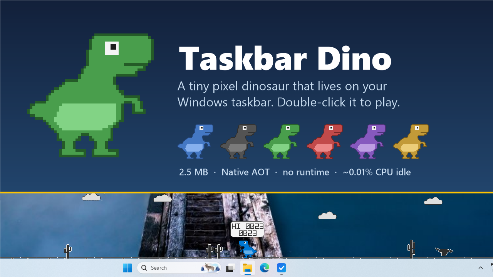
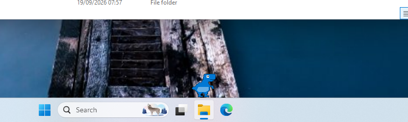
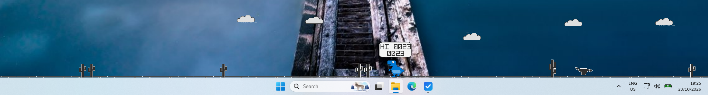
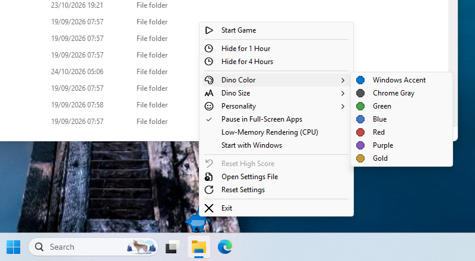
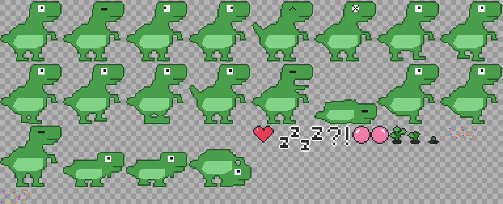

# Taskbar Dino



A tiny pixel-art dinosaur that lives on your Windows taskbar. It sits on the active app's taskbar
button, follows you from app to app, reacts to your mouse, and turns into a Chrome-Dino style
runner when you double-click it. It is a single 2.5 MB executable with no runtime to install, and
it costs effectively nothing while it sits there.

**[Download the latest release](../../releases/latest)** (Windows x64, unzip and run).







## Features

- **Follows the active app.** When you switch to Visual Studio, a browser or File Explorer, the dino
  hops over to that app's taskbar button (found through UI Automation, so pinned apps, Store apps
  and Edge web apps work). With no app active it waits on the Start button. Works across monitors.
- **A little personality.** Blinks, glances around, wags its tail, scratches, stretches, yawns,
  gets curious, nibbles a sprout, plays with a ball, celebrates, and lies down to sleep after a
  while. Its head follows your cursor when you hover. Short trips are walked, longer ones run, and
  only far ones start with a leap.
- **Mouse play.** Click it for a happy hop; drag it anywhere on the desktop and it falls, looks
  around and runs back home; right-click for the menu.
- **Game Mode.** Double-click (or *Start Game* in the menu) and the taskbar becomes a runner: jump
  cacti and pterodactyls, duck under the low ones, scrolling ground and drifting clouds, a HI-score
  bubble, a proper game-over screen with restart. The stage is transparent; only the game elements
  are drawn.
- **Stays out of the way.** Click-through overlay, never takes focus, hidden from Alt+Tab, hides
  itself behind full-screen apps, and can be told to hide for an hour or four.
- **Six colours plus one that follows your Windows accent colour**, four sizes (Medium is the
  art's native 48 px), three personality levels, optional start with Windows. The menu uses the
  Windows 11 Fluent icon font.
- **Ultra-light.** Native AOT, no third-party runtime dependencies, adaptive rendering that draws
  only when the picture changes and sleeps otherwise. See [docs/PERFORMANCE.md](docs/PERFORMANCE.md).

## Requirements

- Windows 11 (Windows 10 also works; the taskbar button lookup is tuned for Windows 11).
- x64. No .NET runtime needed.
- A GPU is optional: without one the app uses the WARP software rasteriser automatically.

## Installation

1. Download `TaskbarDino-<version>-win-x64.zip` from the [releases](../../releases/latest), or build
   it (below).
2. Unzip anywhere (for example `%LOCALAPPDATA%\Programs\TaskbarDino`) and run `TaskbarDino.exe`.
   The executable is not code-signed, so the first launch may show *Windows protected your PC*:
   choose **More info → Run anyway**.
3. Optionally turn on **Start with Windows** in the dino's menu. It registers a per-user Run key;
   nothing requires administrator rights.

To uninstall: exit the dino from its menu, delete the folder, and remove
`%LOCALAPPDATA%\TaskbarDino` (settings and high score). If start-with-Windows was on, turn it off
first or delete the `TaskbarDino` value under `HKCU\Software\Microsoft\Windows\CurrentVersion\Run`.

## Controls

| Action | Effect |
|---|---|
| Hover | The dino looks at the cursor |
| Click | Happy hop |
| Double-click | Start Game Mode |
| Drag and release | Carry the dino; it falls, looks around and runs home |
| Right-click (dino or tray icon) | Menu |
| **Space / ↑ / Enter** (in game) | Jump — hold for a higher, longer jump |
| **↓** (in game) | Duck; in the air, drop faster |
| **Esc** (in game) | Leave Game Mode |
| **Space / Enter** (after game over) | Restart |

While a game is running, Space, the arrow keys, Enter and Esc are reserved for the game. Press Esc
to hand them back. Outside Game Mode no key is intercepted.

## Settings

Everything is in the right-click menu:

- **Start Game / Stop Game**
- **Hide for 1 Hour / 4 Hours** (and **Show Dino Now** while hidden). The timer is wall-clock, so it
  survives restarts and sleep.
- **Dino Color**: Windows Accent, Chrome Gray, Green, Blue, Red, Purple, Gold
- **Dino Size**: Tiny (24 px), Small (36 px), Medium (48 px, native), Large (72 px) — all at 100 % DPI; sizes scale with the monitor's DPI
- **Personality**: Calm, Normal, Lively (how often it does things)
- **Pause in Full-Screen Apps**: hide while a game, video or presentation is full screen
- **Low-Memory Rendering (CPU)**: draw with the WARP software rasteriser instead of the GPU. Same
  picture; saves the memory the GPU driver would otherwise occupy in the process.
- **Start with Windows**
- **Reset High Score**, **Open Settings File**, **Reset Settings**, **Exit**

Settings live in `%LOCALAPPDATA%\TaskbarDino\settings.json`. A corrupt file is moved aside and
defaults are used.

## Building

Prerequisites: .NET 10 SDK and, for the Native AOT publish, Visual Studio 2022 or newer (or Build
Tools) with the *Desktop development with C++* workload.

```powershell
dotnet build TaskbarDino.slnx -c Release      # build
dotnet test TaskbarDino.slnx -c Release       # unit tests (pure logic, runs on any OS)
.\build\publish.ps1                           # Native AOT publish -> artifacts\publish\TaskbarDino.exe + zip
```

`dotnet run src\TaskbarDino\TaskbarDino.csproj` runs the framework-dependent build for development.
Add `--log` to write `%LOCALAPPDATA%\TaskbarDino\taskbardino.log`.

Developer tools: `python tools/dino-art.py` regenerates the pose grids (`DinoArt.cs`, `GameArt.cs`)
from the shapes that define the dino; `dotnet run tools/sprite-preview.cs -- <dir>` renders the
sprite sheets to PNG; `dotnet run tools/make-icon.cs -- src/TaskbarDino/Assets/TaskbarDino.ico`
regenerates the app icon from the dino art. `TaskbarDino.exe --menu-preview` opens the context
menu by itself for a screenshot; `--game --autopilot` runs the game unattended for benchmarks.



See [docs/ARCHITECTURE.md](docs/ARCHITECTURE.md) for how it is put together, and
[docs/VALIDATION.md](docs/VALIDATION.md) for what was tested and how.

## Known limitations

- **Game keys are global while a game runs.** The dino never takes keyboard focus, so Game Mode
  listens through a low-level hook and consumes Space, ↑, ↓, Enter and Esc system-wide until you
  press Esc. Nothing is intercepted outside Game Mode.
- **Taskbar button lookup is best effort.** It is exact for apps whose taskbar button carries their
  App User Model ID (most pinned, Store and web apps) or whose button label shares words with the
  window title. For the rest (and when no app is active) the dino uses the Start button.
- **Vertical taskbars** (left/right docking on Windows 10) are handled for geometry but the game
  stage always runs along the bottom of the screen.
- No sounds.
- x64 only.

## License

MIT. The dinosaur and all game art are original pixel art generated by the app at runtime; the game
borrows the *feel* of Chromium's offline runner (speed ramp, gravity, gap coefficient, parallax
clouds) without copying its code or sprites.
